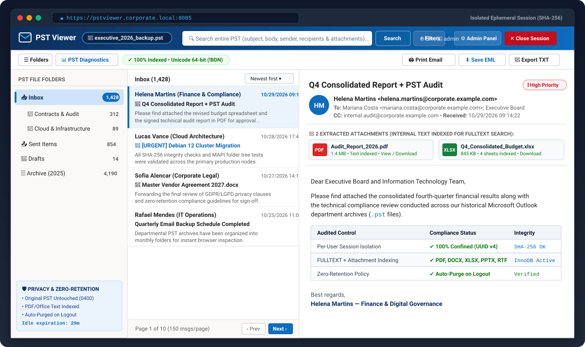
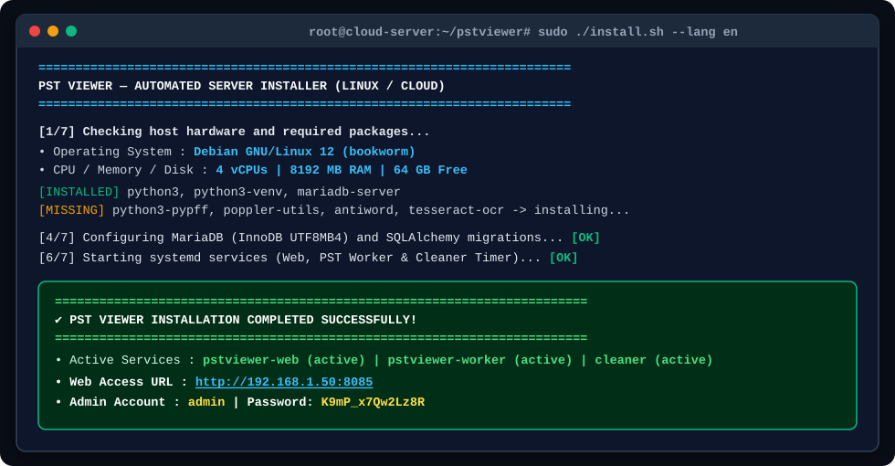
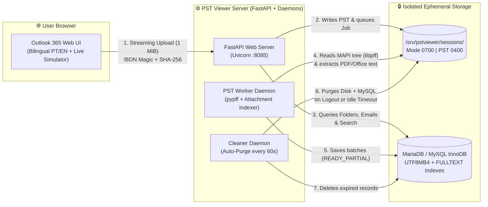

<div align="center">

<!-- INTERACTIVE LANGUAGE SWITCHER -->
<p align="center">
  <a href="README.md">
    
  </a>
  &nbsp;&nbsp;
  <a href="README.en.md">
    
  </a>
</p>

# 📧 PST Viewer
### Enterprise Web Platform for Opening, Deep Searching, and Inspecting Microsoft Outlook (`.pst`) Archives

[](https://www.python.org/)
[](https://fastapi.tiangolo.com/)
[](https://mariadb.org/)
[](#architecture--data-flow)
[](#option-2-docker--docker-compose-windows-macos-linux-or-cloud)
[-107c10?style=for-the-badge&logo=shield&logoColor=white)](#security-isolation--auto-purge)

<p align="center">
  <strong>Outlook 365 Web Interface + Live Simulator • Deep search across emails &amp; attachments (PDF/Office) • 1-Click Bilingual Setup (EN / PT)</strong>
</p>

[Overview](#-overview) •
[Outlook 365 Interface & Simulator](#-outlook-365-web-interface--live-simulator) •
[Quick Start Installation](#-turnkey-installation-run--use-immediately) •
[Architecture](#-architecture--data-flow) •
[Admin & CLI Commands](#-management--administration-commands)

</div>

---

## 🎯 Overview

**PST Viewer** is a modern web application designed to **open, search, print, and export messages and attachments from Microsoft Outlook `.pst` backup files** directly in the browser — without requiring Microsoft Outlook on the user's machine and **without retaining sensitive data permanently on the server**.

> [!IMPORTANT]
> **Zero-Retention Philosophy (Ephemeral Reading Room):**
> The system is **not a permanent email vault**. Your original `.pst` file on your computer or network share is **never modified** (`0400 read-only`), each reading session runs in an isolated container (`0700`), and as soon as you click **"Close Session"**, **Sign Out**, or reach the idle timeout, **100% of the temporary reading data is purged from disk and MySQL**.

---

## 🖥️ Outlook 365 Web Interface & Live Simulator

Below is the 3-pane workspace inspired by **Microsoft Outlook 365 Web**:

<div align="center">
  
</div>

### ✨ Key Experience Highlights

| Feature | Technical Description |
| :--- | :--- |
| 🌍 **Interactive Bilingual UI & Installers (`EN` / `PT`)** | Switch between **🇺🇸 English** and **🇧🇷 Portuguese** at any time with 1 click in the top bar (or choose your language during CLI installation). |
| 🖥️ **Live Outlook 365 Simulator on Home Screen** | Includes an interactive Outlook 365 Web preview right on the sign-in screen with sample folders and fictitious emails so users can test the interface immediately. |
| 📂 **Smart Clean Folder Tree** | Automatically hides internal MAPI system folders (`SPAM Search Folder`, `Search Root`), empty folders (`Deleted Items` with 0 messages), and empty root wrappers, showing directly your real backed-up folders. |
| ⚡ **Progressive Opening (`READY_PARTIAL`)** | No need to wait for a multi-gigabyte PST to finish indexing: as soon as the first folder is mapped, the reader unlocks while background indexing continues. |
| 🔍 **Global Search + Attachment Content** | `FULLTEXT` search combined with filters by folder, sender, recipient (`To`/`CC`/`BCC`), date range, and text extracted from inside **PDF, DOCX, XLSX, PPTX, RTF, DOC, TXT, CSV, HTML, and ZIP** files. |
| 🛡️ **Sanitized Sandbox Reading** | HTML emails are sanitized with `nh3` and rendered inside a strict `iframe sandbox`, blocking malicious scripts (`XSS`), forms, and external trackers. |
| 🖨️ **`.EML`, `.TXT` Export & Clean A4 Print** | Download individual emails in universal **RFC 5322 (`.eml`)** or plain text (`.txt`), or generate a clean A4 print sheet ready for paper or PDF. |
| 🚀 **Automatic Boot Startup** | Starts automatically with the operating system on **Linux** (`systemd`), **Windows + XAMPP** (even starting XAMPP's MySQL in the background), and **Docker** (`restart: unless-stopped`). |

---

## 🚀 Turnkey Installation ("Run & Use Immediately")

**PST Viewer** includes smart bilingual installers that **check host requirements**, **warn about missing packages**, **configure the database and background services automatically**, and **let you choose (or auto-generate) the `admin` password**.

<div align="center">
  
</div>

---

### 🐧 Option 1: Linux or Cloud Server (Debian / Ubuntu / DietPi / VPS) — *Recommended*

Ideal for dedicated servers, virtual machines, or cloud instances (AWS, Oracle Cloud, DigitalOcean, Hetzner, Proxmox, DietPi).

```bash
# 1. Clone the official repository
git clone https://github.com/frederigi/pstviewer.git
cd pstviewer

# 2. Make the installer executable and run it in English (or choose interactively)
chmod +x install.sh
sudo ./install.sh --lang en
```

> [!TIP]
> **100% Unattended Mode & Useful Flags:**
> * Run without interactive prompts in English:
>   ```bash
>   sudo ./install.sh --lang en --yes
>   ```
> * Choose or reset the `admin` password and unlock the account at any time:
>   ```bash
>   chmod +x reset_password.sh
>   sudo ./reset_password.sh
>   ```
> * **Fast SSH Update** on an existing Linux/Cloud server (preserves your database and `config/pstviewer.env`):
>   ```bash
>   chmod +x update.sh
>   sudo ./update.sh
>   ```
>   *(If pulling from internal Gitea or while GitHub repo is private, the script falls back automatically to Gitea `http://10.14.127.225:3000/anderson/pstviewer.git` or you can pass the URL as argument!)*

---

### 🐳 Option 2: Docker & Docker Compose (Windows, macOS, Linux, or Cloud)

The fastest way to run on **any operating system** with **100% of native C dependencies (`libpff`, `poppler`, `antiword`, `tesseract`) and MariaDB 11 pre-configured**:

```bash
# 1. Clone the repository
git clone https://github.com/frederigi/pstviewer.git
cd pstviewer

# 2. Build and start all containers (MariaDB + Web + PST Worker + Cleaner)
docker compose up -d --build
```

```bash
# 3. Display or set the Administrator (admin) password
docker exec -it pstviewer-web /opt/pstviewer/venv/bin/python /opt/pstviewer/scripts/create_admin.py
```

* 🌐 **Web Access URL:** `http://localhost:8085`

---

### 💻 Option 3: Windows with XAMPP (or Local MySQL)

Ideal for running locally on Windows using **XAMPP's MySQL/MariaDB database** (zero manual database setup or phpMyAdmin needed).

#### Step 1: Install base requirements on Windows (if not already installed)

```powershell
# Installs XAMPP, Python 3.12, and Git automatically via winget:
winget install -e --id ApacheFriends.Xampp.8.2
winget install -e --id Python.Python.3.12
winget install -e --id Git.Git
```

#### Step 2: Clone the Project & Run the 1-Click Installer (`install_windows_xampp.bat`)

```powershell
git clone https://github.com/frederigi/pstviewer.git
cd pstviewer
.\install_windows_xampp.bat --lang en
```

*(You can also simply **double-click** `install_windows_xampp.bat` in Windows Explorer and choose `[2] English` on the welcome prompt!)*

**What `install_windows_xampp.bat` + `setup_and_run.py` do automatically:**
1. **Check your machine:** Verify Python version, free disk space, and install pre-compiled binary wheels (`--only-binary=:all:`) without requiring a C++ compiler or Rust.
2. **Auto-start & connect to XAMPP MySQL (`127.0.0.1:3306`):** If `C:\xampp\mysql\bin\mysqld.exe` is stopped, the installer starts it automatically in the background and creates the `pstviewer` (`utf8mb4_unicode_ci`) database.
3. **Run migrations & configure Admin:** Apply all InnoDB tables and `FULLTEXT` indexes, and prompt you to choose your `admin` password (or press `ENTER` to generate one).
4. **Launch Background Daemons & Register Windows Auto-Boot:** Start the Web Server (`http://127.0.0.1:8085`), PST Worker, and Cleaner completely detached from the console (`pythonw.exe` + Windows Startup registration). **You can close PowerShell/CMD and the app keeps running!**

**1-Click Windows Shortcuts & CLI Commands:**

* 🔑 **`reset_admin_password.bat`** *(double-click)*: Choose or generate a new password for `admin` and ensure the server is running.
* 🛑 **`stop_windows.bat`** *(double-click)*: Stop all background PST Viewer processes immediately.

```powershell
# Check background service status and PIDs:
.\venv\Scripts\python.exe setup_and_run.py --lang en --status

# Stop all background services:
.\venv\Scripts\python.exe setup_and_run.py --lang en --stop

# Reset the 'admin' password:
.\venv\Scripts\python.exe setup_and_run.py --lang en --reset-admin
```

---

## 🏗️ Architecture & Data Flow



---

## 🛠️ Management & Administration Commands

```bash
# 1. Grant execution permission (if needed)
chmod +x update.sh

# 2. Update via official GitHub:
sudo ./update.sh

# OR update via internal Gitea (ideal while GitHub repo is private):
sudo ./update.sh http://10.14.127.225:3000/anderson/pstviewer.git
```

# Check real-time status of all 3 systemd services:
sudo systemctl status pstviewer-web.service pstviewer-worker.service pstviewer-cleaner.timer

# Follow PST extraction logs in real time:
sudo journalctl -u pstviewer-worker.service -f

# Restart web application and worker:
sudo systemctl restart pstviewer-web.service pstviewer-worker.service
```

---

## 📂 Repository Structure

```ini
pstviewer/
├── app/
│   ├── api/                  # REST Endpoints (Auth, Sessions, Reader, Global Search, Export, Admin)
│   ├── auth/                 # Argon2id security, sessions, CSRF & per-user access control
│   ├── core/                 # Environment loader (.env) & sanitized audit engine
│   ├── database/             # SQLAlchemy 2.0 models, PyMySQL engine & auto-migrations
│   ├── services/             # MAPI extractor (pypff), attachment parser, HTML sanitizer & cleaner
│   ├── static/               # Outlook 365 stylesheet (outlook.css) & bilingual SPA + Simulator (app.js)
│   ├── templates/            # Responsive web interface (index.html)
│   ├── workers/              # Background daemons (pst_worker.py & cleaner_daemon.py)
│   └── main.py               # FastAPI bootstrap & Content-Security-Policy (CSP) headers
├── config/
│   └── pstviewer.env.example # Documented environment variables template
├── database/
│   └── schema_v1.sql         # Full MySQL/MariaDB InnoDB UTF8MB4 schema
├── docs/assets/              # Vector illustrations (PT & EN) for documentation
├── scripts/                  # CLI utilities (create_admin.py) & automated test suites
├── Dockerfile                # Debian Bookworm image with libpff, poppler, antiword & tesseract
├── docker-compose.yml        # Turnkey multi-container orchestration
├── install.sh                # Bilingual unified automated installer for Linux / Cloud VPS
├── update.sh                 # Fast SSH updater for Linux / Cloud servers
├── reset_password.sh         # Fast Linux script to set/reset admin password & unlock account
├── install_windows_xampp.bat # 1-click automated installer & launcher for Windows + XAMPP
├── reset_admin_password.bat  # 1-click Windows shortcut to set/reset admin password
├── stop_windows.bat          # 1-click Windows shortcut to stop background services
├── setup_and_run.py          # Bilingual cross-platform setup & background daemon runner
├── README.md                 # Full documentation in Portuguese (with interactive language bar)
└── README.en.md              # Full documentation in English (with interactive language bar)
```

---

<div align="center">
  <sub>Designed and Developed by <strong>Anderson Gonçalez</strong> — Information Technology</sub>
</div>

