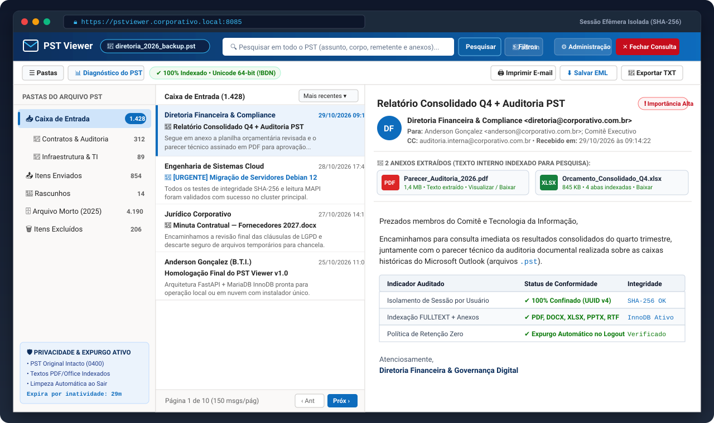
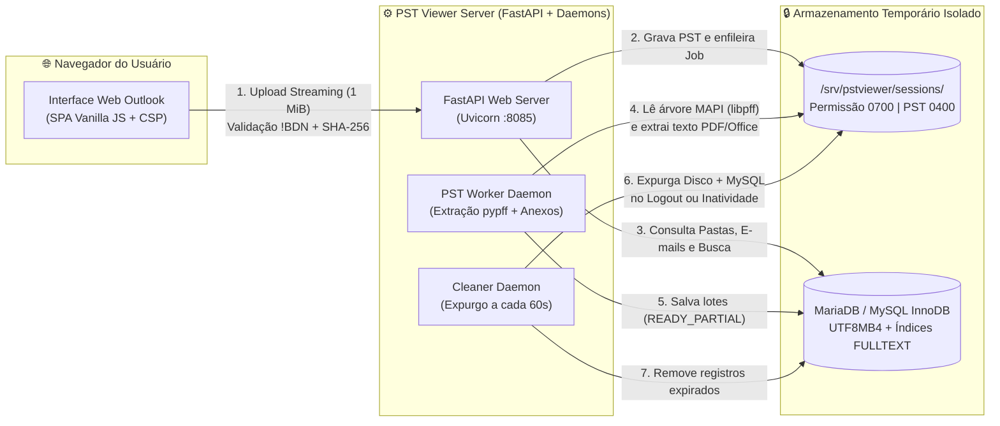

<div align="center">

# 📧 PST Viewer
### Plataforma Corporativa de Inspeção, Leitura e Pesquisa Temporária de Arquivos Microsoft Outlook (`.pst`)

[](https://www.python.org/)
[](https://fastapi.tiangolo.com/)
[](https://mariadb.org/)
[](#arquitetura-e-fluxo-de-dados)
[](#op%C3%A7%C3%A3o-2-docker--docker-compose-windows-macos-linux-ou-cloud)
[-107c10?style=for-the-badge&logo=shield&logoColor=white)](#seguran%C3%A7a-isolamento-e-descarte-autom%C3%A1tico)

<p align="center">
  <strong>Leitor web inspirado no Microsoft Outlook • Pesquisa profunda em e-mails e dentro de anexos (PDF/Office) • Instalação automática em 1 comando</strong>
</p>

[Visão Geral](#-visão-geral) •
[Interface do Leitor](#-interface-do-leitor-estilo-microsoft-outlook) •
[Instalação Rápida](#-instalação-execute-e-saia-usando) •
[Arquitetura](#-arquitetura-e-fluxo-de-dados) •
[Comandos Úteis](#-comandos-de-gerenciamento-e-administração)

</div>

---

## 🎯 Visão Geral

O **PST Viewer** é uma aplicação web corporativa desenvolvida para **abrir, pesquisar, imprimir e exportar pontualmente mensagens e anexos de arquivos `.pst` do Microsoft Outlook** diretamente pelo navegador — sem necessidade de instalar o Microsoft Outlook na máquina do usuário e **sem reter dados permanentemente no servidor**.

> [!IMPORTANT]
> **Filosofia de Retenção Zero (Consulta Efêmera):**
> O sistema **não é um cofre permanente** de e-mails. O arquivo `.pst` original do usuário jamais é modificado (`0400 read-only`), a sessão roda em diretório isolado (`0700`) e, assim que o usuário clica em **"Fechar Consulta"**, faz **Logout** ou atinge o tempo limite de inatividade, **100% das mensagens, anexos e arquivos temporários são fisicamente expurgados do disco e do banco MySQL**.

---

## 🖥️ Interface do Leitor (Estilo Microsoft Outlook)

Abaixo está a visualização da área de trabalho em **3 painéis** gerada a partir do layout nativo da aplicação (`Fluent UI / Outlook Web`):

<div align="center">
  
</div>

### ✨ Destaques da Experiência de Uso

| Recurso | Descrição Técnica |
| :--- | :--- |
| 📂 **Árvore MAPI Fiel ao Outlook** | Reconhecimento e ordenação automática de *Caixa de Entrada*, *Itens Enviados*, *Rascunhos*, *Arquivo Morto*, *Lixo Eletrônico*, *Itens Excluídos* e subpastas personalizadas. |
| ⚡ **Abertura Progressiva (`READY_PARTIAL`)** | Não é preciso esperar um PST de vários Gigabytes terminar para começar a ler: assim que a 1ª pasta é mapeada, o leitor já é liberado enquanto o worker indexa o restante em background. |
| 🔍 **Pesquisa Global + Conteúdo de Anexos** | Busca `FULLTEXT` combinada com filtros por pasta, remetente, destinatário (`Para`/`CC`/`CCO`), período de datas e textos extraídos de dentro de arquivos **PDF, DOCX, XLSX, PPTX, RTF, DOC, TXT, CSV, HTML e ZIP**. |
| 🛡️ **Leitura Sanitizada em Sandbox** | Renderização de e-mails HTML higienizada via `nh3` dentro de `iframe sandbox`, bloqueando execução de scripts (`XSS`), formulários maliciosos e rastreadores. |
| 🖨️ **Exportação `.EML`, `.TXT` e Impressão A4** | Download individual de e-mails no padrão **RFC 5322 (`.eml`)** ou texto puro (`.txt`), além de folha de impressão limpa pronta para PDF/papel. |
| ⚙️ **Painel Administrativo Integrado** | Gestão completa de usuários, bloqueio/desbloqueio de contas, redefinição de senhas, monitoramento de sessões ativas, uso de disco e trilha de auditoria. |

---

## 🚀 Instalação "Execute e Saia Usando"

O **PST Viewer** conta com instaladores inteligentes que **verificam os requisitos da máquina**, **avisam o usuário sobre o que falta instalar**, **configuram o banco e os serviços sozinhos** e **exibem o usuário `admin` e a senha gerada no final**.

<div align="center">
  
</div>

---

### 🐧 Opção 1: Servidor Linux ou Nuvem (Debian / Ubuntu / DietPi / VPS) — *Recomendado*

Ideal para servidores dedicados, máquinas virtuais ou instâncias em nuvem (AWS, Oracle Cloud, DigitalOcean, Hetzner, Proxmox, DietPi).

```bash
# 1. Clone o repositório oficial
git clone https://github.com/frederigi/pstviewer.git
cd pstviewer

# 2. Dê permissão de execução e inicie o instalador automático
chmod +x install.sh
sudo ./install.sh
```

> [!TIP]
> **Modo 100% Autônomo (Sem confirmação manual):**
> Se quiser rodar em scripts de provisionamento sem perguntas na tela, adicione a flag `--yes`:
> ```bash
> sudo ./install.sh --yes
> ```
> Para **gerar uma nova senha** para o usuário `admin` a qualquer momento:
> ```bash
> sudo ./install.sh --reset-admin
> ```

**O que o `install.sh` faz por você:**
1. Analisa CPU, memória RAM, espaço livre em disco e verifica todos os pacotes APT (`python3-pypff`, `mariadb-server`, `poppler-utils`, `antiword`, `catdoc`, `tesseract-ocr`).
2. Avisa na tela quais pacotes já estão presentes (`[INSTALADO]`) e quais serão baixados (`[PENDENTE]`).
3. Cria o usuário de sistema sem privilégios (`pstviewer`) e diretórios confinados (`/srv/pstviewer/sessions`).
4. Configura o banco **MariaDB/MySQL (`InnoDB utf8mb4`)** e aplica todas as migrações automaticamente.
5. Registra e inicia os 3 serviços `systemd`: `pstviewer-web.service`, `pstviewer-worker.service` e `pstviewer-cleaner.timer`.
6. Exibe o quadro verde com a **URL de acesso**, **Usuário (`admin`)** e **Senha gerada**.

---

### 🐳 Opção 2: Docker & Docker Compose (Windows, macOS, Linux ou Cloud)

A maneira mais rápida de rodar em **qualquer sistema operacional** com **100% das dependências C (`libpff`, `poppler`, `antiword`, `tesseract`) e banco MariaDB 11 já embutidos**:

```bash
# 1. Clone o repositório
git clone https://github.com/frederigi/pstviewer.git
cd pstviewer

# 2. Suba toda a infraestrutura (Banco MariaDB + Web + Worker PST + Cleaner)
docker compose up -d --build
```

```bash
# 3. Exiba ou gere a credencial do usuário Administrador (admin)
docker exec -it pstviewer-web /opt/pstviewer/venv/bin/python /opt/pstviewer/scripts/create_admin.py
```

* 🌐 **Endereço de Acesso:** `http://localhost:8085`

---

### 💻 Opção 3: Instalação do Zero no Windows com XAMPP (ou MySQL Local)

Ideal para quem deseja rodar o sistema localmente no Windows aproveitando o banco **MySQL/MariaDB do XAMPP** (sem precisar configurar banco de dados manualmente nem criar tabelas no phpMyAdmin).

> [!NOTE]
> **Como o PST Viewer usa o XAMPP?**
> O PST Viewer é uma aplicação **Python (FastAPI)** com servidor web próprio (`Uvicorn`). Ele **não usa o Apache/PHP** (`htdocs`), mas **usa automaticamente o banco de dados MySQL/MariaDB do XAMPP** na porta `3306` (usuário padrão `root` sem senha).

#### Passo 1: Instalar os 2 requisitos base no Windows (caso ainda não tenha)

Se a máquina estiver totalmente do zero, instale via terminal (**PowerShell**) com um único comando via `winget` (ou baixe pelos instaladores oficiais):

```powershell
# Instala o XAMPP, o Python 3.12 e o Git automaticamente no Windows:
winget install -e --id ApacheFriends.Xampp.8.2
winget install -e --id Python.Python.3.12
winget install -e --id Git.Git
```

#### Passo 2: Baixar o Projeto e Iniciar o MySQL do XAMPP

1. Abra o **XAMPP Control Panel** e clique em **Start** apenas na linha **MySQL** (até ficar verde na porta `3306`).
   *(Se o XAMPP estiver em `C:\xampp`, o próprio instalador do Passo 3 consegue iniciar o MySQL sozinho caso você esqueça!)*
2. No **PowerShell** ou **Prompt de Comando (CMD)**, baixe o projeto na pasta de sua preferência:

```powershell
git clone https://github.com/frederigi/pstviewer.git
cd pstviewer
```

#### Passo 3: Executar o Instalador Automático (`install_windows_xampp.bat`)

Você pode dar **duplo clique** no arquivo `install_windows_xampp.bat` na pasta do projeto ou executá-lo pelo terminal:

```powershell
.\install_windows_xampp.bat
```

> [!TIP]
> **Preferindo rodar direto via Python (Windows, Linux ou macOS com MySQL local):**
> ```powershell
> # Cria o ambiente virtual, instala as dependências e executa o assistente:
> python -m venv venv
> .\venv\Scripts\activate
> pip install -r requirements.txt
> python setup_and_run.py
> ```

**O que o `install_windows_xampp.bat` + `setup_and_run.py` fazem sozinhos do zero:**
1. **Verificam a máquina:** Checam a versão do Python (oferecendo instalar via `winget` se ausente), o espaço livre em disco e as bibliotecas necessárias.
2. **Iniciam e conectam no MySQL do XAMPP (`127.0.0.1:3306`):** Se o MySQL do `C:\xampp` estiver parado, o script o inicia automaticamente; em seguida, conecta com o usuário `root` e cria o banco `pstviewer` (`utf8mb4_unicode_ci`) sem que você precise abrir o phpMyAdmin.
3. **Criam o ambiente isolado (`venv`) e o arquivo `config/pstviewer.env`:** Configuram automaticamente as pastas temporárias locais (`./storage/sessions`, `./storage/quarantine`, `./storage/logs`).
4. **Executam as migrações:** Criam todas as tabelas InnoDB e índices `FULLTEXT` automaticamente.
5. **Geram o usuário Administrador:** Criam a conta **`admin`** e **exibem a senha gerada em destaque na tela**.
6. **Iniciam os 3 Serviços Juntos:** Sobem o Servidor Web (`http://127.0.0.1:8085`), o Worker de Extração PST e o Guardião de Limpeza na mesma janela.

**Comandos avançados do assistente (`setup_and_run.py`):**

```powershell
# Caso o seu MySQL tenha senha no root ou rode em outra porta:
python setup_and_run.py --db-host 127.0.0.1 --db-port 3306 --db-user root --db-password "SUA_SENHA" --port 8085

# Gerar uma nova senha para o usuário 'admin' a qualquer momento:
python setup_and_run.py --setup-only --reset-admin
```

---

## 🏗️ Arquitetura e Fluxo de Dados



---

## 🔒 Segurança, Isolamento e Descarte Automático

> [!WARNING]
> **Regra de Arquitetura — Proibição Estrita de SQLite:**
> Por exigência de concorrência, integridade transacional (`SAVEPOINT` por mensagem/anexo) e índices `FULLTEXT`, o sistema opera **exclusivamente com MySQL / MariaDB (`InnoDB`)**. Qualquer tentativa de configurar SQLite é bloqueada imediatamente na inicialização.

* **Validação Binária Real (`!BDN`):** Arquivos enviados com extensão `.pst` falsa são rejeitados nos primeiros `564 bytes` durante o streaming na quarentena antes mesmo de ocupar disco.
* **Proteção contra *Zip Bomb* e Anexos Criptografados:** Pacotes Office (`.docx`, `.xlsx`, `.pptx`) e arquivos `.zip` têm taxa de compressão e quantidade de entradas inspecionadas antes da extração textual.
* **Senhas com Hash `Argon2id`:** Autenticação com bloqueio temporário automático após tentativas inválidas (`login_lockout_minutes`), cookies `HttpOnly` + `SameSite=Lax` e validação de token `X-CSRF-Token`.
* **Auditoria Sanitizada:** A tabela `audit_logs` e o arquivo `/var/log/pstviewer/audit/audit.log` registram eventos operacionais (`LOGIN_SUCCESS`, `UPLOAD_DONE`, `EXTRACT_DONE`, `SESSION_PURGED`, `AUTHZ_DENIED`), filtrando qualquer senha, token ou corpo de mensagem.

---

## 🛠️ Comandos de Gerenciamento e Administração

### Gerenciar Serviços no Linux (`systemd`)

```bash
# Verificar o status em tempo real dos 3 serviços
sudo systemctl status pstviewer-web.service pstviewer-worker.service pstviewer-cleaner.timer

# Acompanhar os logs do extrator PST em tempo real
sudo journalctl -u pstviewer-worker.service -f

# Reiniciar a aplicação web e o worker de processamento
sudo systemctl restart pstviewer-web.service pstviewer-worker.service
```

### Gerenciar Usuários Administradores via CLI

```bash
# Criar novo administrador ou redefinir a senha do usuário 'admin'
sudo PYTHONPATH=/opt/pstviewer PSTVIEWER_ENV_FILE=/opt/pstviewer/config/pstviewer.env \
  /opt/pstviewer/venv/bin/python /opt/pstviewer/scripts/create_admin.py --username admin

# Definir uma senha específica manualmente
sudo PYTHONPATH=/opt/pstviewer PSTVIEWER_ENV_FILE=/opt/pstviewer/config/pstviewer.env \
  /opt/pstviewer/venv/bin/python /opt/pstviewer/scripts/create_admin.py --username admin --password "SuaSenhaForteAqui!"
```

### Executar o Expurgo Manual de Sessões Expiradas

```bash
sudo PYTHONPATH=/opt/pstviewer PSTVIEWER_ENV_FILE=/opt/pstviewer/config/pstviewer.env \
  /opt/pstviewer/venv/bin/python -m app.workers.cleaner_daemon --once
```

---

## 📂 Estrutura de Diretórios do Repositório

```ini
pstviewer/
├── app/
│   ├── api/                  # Endpoints REST (Auth, Sessões, Leitor, Busca Global, Exportação, Admin)
│   ├── auth/                 # Segurança Argon2id, sessões, CSRF e controle de acesso por usuário
│   ├── core/                 # Carregamento de ambiente (.env) e motor de auditoria LGPD
│   ├── database/             # Modelos SQLAlchemy 2.0, conexão PyMySQL e migrações automáticas
│   ├── services/             # Extrator MAPI (pypff), extrator de anexos, sanitizador HTML e limpeza
│   ├── static/               # Folha de estilo Fluent UI (outlook.css) e lógica SPA (app.js)
│   ├── templates/            # Interface web responsiva (index.html)
│   ├── workers/              # Daemons de processamento (pst_worker.py) e limpeza (cleaner_daemon.py)
│   └── main.py               # Inicialização FastAPI e políticas Content-Security-Policy (CSP)
├── config/
│   └── pstviewer.env.example # Modelo documentado de variáveis de ambiente
├── database/
│   └── schema_v1.sql         # DDL completo MySQL/MariaDB InnoDB UTF8MB4
├── docs/assets/              # Ilustrações vetoriais da interface e do instalador para documentação
├── scripts/                  # Utilitários CLI (create_admin.py) e suítes de testes automatizados
├── Dockerfile                # Imagem Debian Bookworm com libpff, poppler, antiword e tesseract
├── docker-compose.yml        # Orquestração completa pronta para uso
├── install.sh                    # Instalador automático unificado para Linux / Cloud VPS
├── install_windows_xampp.bat     # Instalador e inicializador automático (1 clique) para Windows + XAMPP
├── setup_and_run.py              # Assistente multiplataforma para execução com MySQL local / XAMPP
└── requirements.txt              # Dependências Python fixadas
```

---

<div align="center">
  <sub>Desenvolvido por <strong>Anderson Gonçalez</strong> — Tecnologia da Informação (B.T.I.)</sub>
</div>
